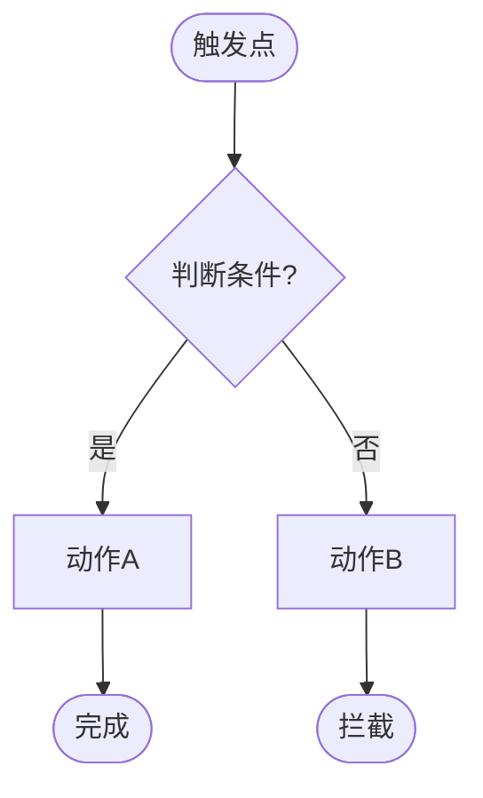

# 测试工程全流程 MVP 流水线（v2.12）

> **定位**：从一句话需求到可交付测试用例集，9 个主阶段（Phase 0–8）+ 4 个子阶段（1.5/2.5/3.5/5.5）的自动执行与人工卡点协同流水线。
> **人类使用手册**：安装、五分钟上手、阶段说明、评测基线的完整操作路径见同目录 `USAGE.md`（本文件是执行规则基线，规则冲突时以本文件为准）。
> **v2.12 重点**：Phase 3 新增「测试点组织与分组规范」——按历史用例功能点方式组织输出（主功能点分组 + 专项与对抗验证统一组件）、类型标签严格四选一（冒烟=P0、遍历=P1 回归、允许多标签）、攻击性轻量锚点 + 独立详表（`异常流程（攻击）` 后缀，Phase 4 评审后决定是否进用例）。来源：v5.3 教学管理实践（2026-08-24 用户确认）。

## 规则基线与冲突优先级（★ v2.3 新增）

本文件 `SKILL.md` 是 test-pipeline-mvp 的**唯一执行规则基线**。当规则手册、Excel 模板、PPT、历史笔记与本文件冲突时：

1. 执行逻辑、门禁、字段语法以当前版本 `SKILL.md` 为准；
2. `test-pipeline-mvp-规则梳理.md` 是面向人的摘要，必须与 SKILL.md 同版本；
3. PPT 是展示层，不得作为执行规则来源；发现漂移必须修摘要/PPT，不得反向覆盖 SKILL.md；
4. 版本升级后必须检查 Phase 3.5 门禁、TP-A 追溯语法、风险评分公式三项机器可校验规则。

---

## 核心设计原则

1. **补全优先**：需求不完整时先追问补全，不跳步骤
2. **交互感知**：每个阶段都主动识别跨模块交互点
3. **人工卡点**：所有标注“等待用户确认”的阶段强制停下，不自动跳过
4. **可追溯**：普通用例回溯到需求/规则，攻击性用例回溯到风险卡、来源测试点和攻击假设；任何用例都不得成为孤立产物
5. **状态版本化**：每阶段输出记录版本、输入摘要和确认状态；上游摘要变化时自动使下游确认和门禁结果失效

## 流水线全貌

```
输入：一句话需求 / 需求文档（PDF/Word/Markdown）
  ↓
Phase 0:   测试范围确认          ← 文档输入必须执行；一句话需求自动标记“不适用”并进入 Phase 1
  ↓ 文档输入等待确认；一句话需求自动进入
Phase 1:   需求分析 & 补全       ← 追问缺失信息，识别模块边界，规则提取建模（★ v2.0 增强）
  ↓ 用户确认
Phase 1.5: 流程图绘制           ← Mermaid 业务流程图 + 节点清单（复杂需求执行并确认；简单需求记录“不适用”）
  ↓ 执行时等待用户确认；不适用时自动进入
Phase 2:   需求拆解              ← 用户故事 + 模块交互矩阵
  ↓ 用户确认
Phase 2.5: 七类风险地图          ← 7类风险卡（正常/边界/权限/异常/幂等/集成/回归）+ 缺资料标注（★ 新增）
  ↓ 用户确认
Phase 3:   测试点生成            ← 七维度覆盖 + 跨模块交互点 + 路径绑定（映射自 Phase 2.5 风险卡）
  ↓ 用户确认
Phase 3.5: 覆盖率验证 ⚡         ← 必执行！双模式：Mermaid 节点覆盖率 / 三层交叉验证
  ↓（自动执行，不通过则阻塞）
Phase 4:   测试点评审            ← 覆盖度检查 + 优先级打分
  ↓ 用户确认/修改
Phase 5:   测试用例生成          ← 12列标准结构 / 18列企业模板(委派 excel-testcase-18col) + 视觉内容处理（★ v2.0 增强；★ v2.7 同步 18列能力）
  ↓ 用户确认
Phase 5.5: 接口用例代码生成      ← 仅接口用例：生成可执行代码 + 失败日志三分法（条件触发）
  ↓ 执行时等待结果确认；无接口用例记录“不适用”并自动进入
Phase 6:   测试用例评审          ← 自动评审 + 三层交叉验证（★ v2.0 增强）
  ↓ 用户确认/批注
Phase 7:   测试用例修改          ← 根据评审意见修改 + 回归 Phase 3.5/6
  ↓ 回归验证通过 + 用户确认
Phase 8:   测试用例确认输出      ← 导出 Excel/Markdown + 覆盖度报告
```

---

## Phase 0：测试范围确认（★ v2.0 新增，来自 auto-testcase-generator）

**触发条件**：输入为需求文档（PDF/Word/Markdown）时必须执行；一句话需求标记为“Phase 0 不适用”，自动进入 Phase 1，不视为绕过门禁

**执行步骤**：

### 0.1 三区域划分

接收文档后先划清测试边界：

| 区域 | 定义 | 处理方式 |
|------|------|---------|
| **Zone 1（核心区）** | 直接测试的功能 | 完整分析并生成用例 |
| **Zone 2（交互区）** | 有交互的外部模块 | 仅作背景知识，生成交互测试点 |
| **Zone 3（外部区）** | 无关内容 | 排除 |

### 0.2 PDF 图片提取（如输入为 PDF）

使用 `scripts/extract_pdf_images.py`（xref+MD5去重+质量过滤），提取文档中嵌入的流程图/状态图/序列图/UI原型。

### 0.3 输出范围确认表

```markdown
## 测试范围确认

**Zone 1（核心区）**：[功能列表]
**Zone 2（交互区）**：[模块列表]
**Zone 3（排除）**：[排除内容及原因]
**嵌入图片**：[已提取X张，其中流程图X张、状态图X张]
```

**→ 输出后等待用户确认，确认后进入 Phase 1**

---

## Phase 1：需求分析 & 补全

**触发条件**：收到任何形式的需求描述（一句话或文档）

**执行步骤**：

### 1.1 需求类型识别

识别需求属于哪种类型：
- 🔵 新功能（首次开发）
- 🟡 功能变更（已有功能修改）
- 🔴 Bug 修复（缺陷引发的补充）
- 🟢 性能/安全优化

### 1.2 需求完整度检查

逐项检查，缺失项自动追问：

| 检查项 | 状态 | 追问模板 |
|--------|------|---------|
| 用户角色 | ？ | "这个功能给哪类用户使用？有没有角色/权限区分？" |
| 前置条件 | ？ | "使用这个功能前，用户需要满足什么条件？" |
| 正常流程 | ？ | "完整的操作流程是什么？分几个步骤？" |
| 异常情况 | ？ | "如果网络断开/数据为空/并发时，系统应该怎么处理？" |
| 成功标准 | ？ | "什么样的结果算这个功能正常工作？" |
| 边界条件 | ？ | "有没有数量限制/长度限制/时间范围限制？" |
| 关联模块 | ？ | "这个功能会影响哪些其他模块？（登录/权限/日志/消息等）" |

### 1.3 规则提取建模（★ v2.0 增强，来自 auto-testcase-generator）

从需求文档中提取五类规则，确保每条规则至少对应1条测试用例：

| 规则类型 | 缩写 | 说明 | 示例 |
|---------|------|------|------|
| 数据规则 | DR | 字段取值、格式、范围约束 | "手机号必须11位" |
| 业务规则 | BR | 业务逻辑、状态转换、计算规则 | "余额不足时禁止交易" |
| 权限规则 | PR | 角色/权限/数据隔离 | "仅管理员可删除" |
| 界面规则 | CR | UI展示、交互约束 | "密码框必须密文显示" |
| 安全规则 | SR | 安全防护、输入过滤 | "防止SQL注入" |

### 1.4 视觉内容处理（★ v2.0 新增，来自 auto-testcase-generator）

当文档包含嵌入图片时，按类型处理：

| 类型 | 方法 | 影响范围 |
|------|------|---------|
| 流程图 | 提取决策节点和路径 | 路径和分支用例 |
| 状态图 | 提取状态和转换条件 | 状态转换用例 |
| 序列图 | 识别消息流和时序 | 集成和时序用例 |
| UI原型 | 分析界面元素 | UI交互用例 |

### 1.5 输出：结构化需求文档

```markdown
## 需求分析卡

**需求描述**：[原始输入]
**需求类型**：[新功能/变更/修复/优化]
**用户角色**：[角色1、角色2...]
**前置条件**：[条件列表]
**正常流程**：[步骤1 → 步骤2 → ...]
**异常情况**：[情况1 → 处理方式，情况2 → 处理方式...]
**成功标准**：[验收标准]
**边界条件**：[边界列表]
**关联模块**：[模块1、模块2...]
**需求缺口**：[待确认项，标注"假设：..."]
**规则清单**：[DR-001: ... | BR-001: ... | PR-001: ... | CR-001: ... | SR-001: ...]
**视觉内容**：[已识别流程图/状态图/序列图数量及关键节点]
```

**→ 输出后等待用户确认，确认后进入 Phase 1.5**

---

## Phase 1.5：流程图绘制（★ v1.2 新增）

**目标**：将核心业务流程可视化，建立测试路径绑定的坐标系

**触发条件**：需求涉及多分支决策、多角色权限、多步骤流程时必须执行；简单单路径需求可标记“不适用”。跳过判定必须记录：命中规则、需求摘要、判定理由和确认状态；无法证明简单单路径时默认执行。

> **Phase 1.5 跳过时的后续处理**：若简单单路径需求不绘制 Mermaid，Phase 3.5 仍必须执行，并从 Phase 1 需求分析卡中自动提取业务动作作为简化节点清单（如 `Start→Create→Done`），确保覆盖率验证不中断。

**输入**：Phase 1 确认的结构化需求文档

**执行步骤**：

### 1.5.1 识别核心流程

从需求分析卡中找出 1~3 个最关键的**主业务流程**，优先选择：
- 包含多个判断分支的主流程
- 涉及多角色权限控制的流程
- 失败路径影响范围大的流程

### 1.5.2 绘制 Mermaid 流程图

使用 `flowchart TD` 格式，为每个节点分配**唯一 ID**：



**节点 ID 命名规范**：

| 节点类型 | 命名格式 | 示例 |
|---------|---------|------|
| 决策节点 | `Check{名称}` | `CheckAdmin`, `CheckToken` |
| 动作节点 | 业务简写 | `P1`（消耗企业Token）, `T1`（教师Token） |
| 成功终止 | `Done` | `Done` |
| 失败终止 | `Block` | `Block` |
| 开始节点 | `Start` | `Start` |

### 1.5.3 输出节点清单

```markdown
## 流程节点清单

| 节点 ID | 节点描述 | 节点类型 | 优先级 |
|--------|---------|---------|------|
| CheckAdmin | 判断是否 admin 账户 | 决策 | P0 |
| P1 | 消耗企业 Token | 动作 | P0 |
| Block | 余额不足拦截 | 终止 | P0 |
| Done | 对话完成 | 终止 | P0 |
```

**评审通过门槛**：
- 流程图覆盖需求中所有主干业务路径
- 所有节点有唯一 ID，无歧义
- 节点清单文件完整输出（供 Phase 3 路径绑定使用）

**参考资源**：`references/phase1_5-flowchart-guide.md`

**→ 输出流程图 + 节点清单后等待用户确认，确认后进入 Phase 2**

---

## Phase 2：需求拆解

**输入**：Phase 1 确认的结构化需求文档

**执行步骤**：

### 2.1 用户故事拆解

将需求拆解为独立的用户故事：
```
作为 [角色]，我希望 [功能]，以便 [价值]
验收标准：Given [前置] When [操作] Then [结果]
```

### 2.2 模块交互矩阵（核心）

> 这是解决"缺少模块间交互考虑"的关键步骤

自动分析当前功能与其他模块的交互关系：

| 当前模块 | 交互模块 | 交互类型 | 交互点描述 | 测试重点 |
|---------|---------|---------|-----------|---------|
| [功能A] | 权限模块 | 数据依赖 | A的操作需要校验权限 | 有权限/无权限/越权 |
| [功能A] | 日志模块 | 事件触发 | A的关键操作需要记录日志 | 日志是否正确记录 |
| [功能A] | 消息通知 | 异步触发 | A完成后触发通知 | 通知是否发出/内容正确 |
| [功能A] | 数据库 | 读写操作 | A涉及的数据表和字段 | 数据一致性/并发写入 |

**常见交互模块清单**（自动对照检查）：
- [ ] 用户认证/权限控制
- [ ] 操作日志/审计日志
- [ ] 消息通知（站内信/邮件/短信）
- [ ] 文件存储/上传下载
- [ ] 数据统计/报表
- [ ] 缓存层
- [ ] 第三方接口
- [ ] 搜索/索引

### 2.3 风险点标注

| 风险项 | 风险等级 | 说明 |
|--------|---------|------|
| 并发操作 | 🔴高 | 多用户同时操作同一数据 |
| 数据一致性 | 🔴高 | 跨表操作的事务完整性 |
| 权限穿透 | 🔴高 | 越权访问其他用户数据 |

**→ 输出后等待用户确认，确认后进入 Phase 2.5**

---

## Phase 2.5：七类风险地图（★ 新增，来自"测试用例别让 AI 硬补"实践）

**目标**：在生成测试点之前，先把"7 类风险"作为一张显式地图摆出来，让产品/研发/测试在同一张桌子上对齐"最怕哪里出错"，并强制标注信息缺口。

**触发条件**：所有需求默认执行（一句话需求可简版）。

**输入**：Phase 1 结构化需求 + Phase 2 模块交互矩阵 + Phase 2 风险点标注 + 历史 bug（如有）

**执行步骤**：

### 2.5.1 七类风险卡

逐类输出：已知事实 / 可能漏测 / 建议测试层级（单元/集成/E2E/手工）/ 必须人工确认的问题。

| 风险类 | 含义 | 对应 Phase 3 七维度 | 常见高风险信号 |
|--------|------|---------------------|----------------|
| 正常路径 | 主流程能否完成 | 功能测试点（Happy Path） | 多分支决策 |
| 输入边界 | 空值/极值/格式/非法输入 | 边界测试点 | 金额/数量/长度/时间 |
| 状态权限 | 角色/状态机/可见范围/越权 | 安全测试点 + 风险点(权限穿透) | RBAC/多租户/数据隔离 |
| 异常失败 | 超时/重试/错误提示/外部失败 | 异常测试点 | 外部依赖/网络 |
| 数据幂等 | 重复提交/并发/回滚/脏数据 | 风险点(并发/一致性) + 集成 | 支付/订单/写操作 |
| 依赖集成 | 数据库/缓存/队列/第三方 | 交互/集成测试点 | 跨服务调用 |
| 回归兼容 | 旧行为/旧接口/老数据/历史 bug | 端到端测试点 + 回归 | 数据迁移/接口变更 |

> 与 Phase 3 七维度是"同一件事的两种视图"：风险地图是**优先级与缺口视图**，七维度是**覆盖实现视图**。两者通过上表一一对应，不重复造轮子。
> **攻击性场景建模（2.5.2）对应 Phase 3「攻击性叠加层」**：风险地图给出"怕哪里错"，攻击性建模给出"怎么让它错"；它横切功能/异常/边界/集成/性能/安全/端到端七个基础维度，不是第 8 个互斥维度。

### 2.5.2 攻击性场景建模（★ v2.3 新增，来自《AI用例的攻击性测试思维》实践）

**目标**：在七类风险地图上叠加"人脑攻击层"。AI 生成的用例只覆盖你"知道"的测试点；攻击性建模负责触达你"没想到"的风险（信任边界 / 隐式约束 / 级联失效）。

**强制思维层**：生成测试点前，对每张风险卡逐张回答三个驱动问题（不可跳过）：

| 驱动问题 | 拷问内容 | 典型产出 |
|---------|---------|---------|
| ① 信任边界在哪？ | 跨进程/跨服务/跨时钟/跨第三方数据处，都假设站着一个恶意"骗子" | 篡改/重放/越界调用补充用例 |
| ② 什么约束是"隐式"的？ | 代码看不见的潜规则（回调先到、缓存 key 恒在、用户不会在回调前注销） | 假设破坏类补充用例 |
| ③ 怎样用最小代价制造级联失效？ | 让服务"半死不活"污染其他模块（请求卡在超时阈值撑满线程池） | 熔断/降级误判类补充用例 |

**四象限适用性预审**：此阶段不要求已有测试点，也不机械生成四条用例。对每张风险卡及其候选高风险来源，按 数据/时序 × 内部/外部 四象限判断是否适用，并记录候选攻击假设；进入 Phase 3 后，再将选中的候选假设绑定到具体来源测试点并生成 TP-A-*。

| 象限 | 拷问 | 示例 |
|------|------|------|
| 数据×内部 | 连接池恰好耗尽时回滚是否完整 | — |
| 数据×外部 | 第三方单号中途数字变字母，序列化崩不崩 | — |
| 时序×内部 | 系统时间被 NTP 回调，超时判断会不会永久挂起 | — |
| 时序×外部 | 回调与查询竞态，会不会产生既"成功"又"失败"的幽灵订单 | — |

> 实测参考：180 条 AI 用例经四维展开 → 衍生近 40 条高价值反直觉用例；80% 致命缺陷藏在最初"不可能发生"的象限。该数据仅作经验参考，不是生成数量或覆盖率配额。

### 2.5.3 缺资料标注（强制）

每一类若缺少判断依据（权限规则、边界值、历史 bug、并发要求等），必须显式写"缺资料"，**不允许 AI 编造业务规则或历史 bug**。

### 2.5.4 输出：七类风险地图

```markdown
## 七类风险地图

| 风险卡ID | 风险类 | 已知事实 | 可能漏测 | 候选攻击假设（含唯一ID） | 建议层级 | 初始风险等级 | Top5标记 | 必须人工确认 | 信息缺口 |
|----------|--------|----------|----------|--------------------------|----------|--------------|----------|--------------|----------|
| RISK-001 | 正常路径 | ... | ... | AH-001：[破坏假设/象限/类别] | E2E | 高 | Y | ... | - |
| RISK-002 | 输入边界 | ... | ... | AH-002：[...] | 单元 | 中 | N | ... | 极值未给(缺资料) |
| RISK-003 | 状态权限 | ... | ... | AH-003：[...] | 集成 | 高 | Y | 权限矩阵需研发确认 | - |
| ... | | | | | | | | | |

**风险地图版本**：RM-vN（每次确认后递增）
**Top5 风险清单**：RISK-xxx, RISK-xxx, ...（按初始风险等级、业务影响和用户确认确定）
**确认记录**：确认人 / 日期 / 调整项
```

- 风险卡使用 `RISK-001...` 唯一编号；候选攻击假设使用 `AH-001...` 唯一编号。
- Top5 必须来自当前已确认的风险地图版本，不得在 Phase 3/3.5 临时新增或替换；如需调整，回到 Phase 2.5 生成新版本并使下游状态失效。
- 一句话需求也必须输出简版风险地图、ID、Top5 和版本，不得省略追溯基线。

**→ 输出后等待用户确认（补全缺口/调整优先级），确认后冻结风险地图版本并进入 Phase 3**

---

## Phase 3：测试点生成

**输入**：Phase 2 确认的拆解结果 + 模块交互矩阵 + Phase 2.5 已确认的七类风险地图、候选攻击假设与信息缺口

**七维度覆盖设计**：

### 维度1：功能测试点
- 正向流程：每个用户故事的 Happy Path
- 数据录入：每个输入字段的正常输入

### 维度2：异常测试点
- 网络异常（断网/超时/重试）
- 数据异常（空值/超长/特殊字符/SQL注入）
- 操作异常（重复提交/乱序操作/快速点击）

### 维度3：边界测试点
- 数值边界：最小值-1、最小值、最大值、最大值+1
- 长度边界：0字符、最大字符、最大字符+1
- 时间边界：过期时间、临界时间点

### 维度4：集成/交互测试点（重点）
> 从 Phase 2 模块交互矩阵逐行生成
- 权限模块交互测试点
- 日志模块交互测试点
- 通知模块交互测试点
- ...

### 维度5：性能测试点
- 单用户操作响应时间
- 大数据量下的列表加载
- 批量操作性能

### 维度6：安全测试点
- 权限控制（RBAC）
- 数据隔离（多租户）
- 输入过滤（XSS/SQL注入）

### 维度7：端到端测试点
- 完整业务流程串联（覆盖核心场景）
- 跨功能模块的联动验证

### 攻击性叠加层：攻击性测试点（★ v2.3 新增，横切七维度）

> 这不是与七维度并列的第 8 个互斥维度，而是对七维度中被选中的高风险测试点做"攻击性展开"。来源：Phase 2.5 攻击性场景建模（三驱动问题 + 四象限适用性检查）。

- **攻击假设落地**：从当前已确认的 RM 版本中选择候选攻击假设，绑定到 Phase 3 已生成的具体高风险来源测试点。每个 TP-A-* 必须记录 RM 版本、来源风险卡、攻击假设 ID、来源测试点、攻击类别和适用象限；不得引用其他版本或临时创建的 ID。
- **四象限检查**：对每个高风险来源测试点逐象限确认是否适用（数据×内部 / 数据×外部 / 时序×内部 / 时序×外部）；不适用必须记录理由，不要求机械生成 4 条用例。
- **攻击后恢复验证**：保留必要的正常/恢复测试点以验证系统在攻击或故障后可恢复；是否合并普通测试点按风险、覆盖等价性和合规职责判断，不做固定比例删减。

### 测试点组织与分组规范（★ v2.12 新增，来自 v5.3 教学管理实践）

**说明**：七维度覆盖设计是"覆盖思维"，本规范是"输出组织方式"。两者不冲突——七维度保证覆盖完整，分组规范决定测试点文档的呈现结构。**按历史用例功能点方式组织输出，不强行套 A/B/C 字母节。**

#### ① 主功能点分组（业务域）
- 按**历史用例功能点方式**组织（界面显示验证 / 列表数据与筛选 / 导出与导出记录 / 查看详情 / 新增修改删除 / 生效失效…），**有则加、无则省，不凑节数**
- **允许模块自定义命名**，命名依据：需求文档 + demo + 导出模板等参考资料
- 语义化命名：「模块-功能点」（如「未入班-智能体下拉指标」「学生列表-实训发布Tab」）

#### ② 专项与对抗验证（统一组件）
所有跨切面验证收口到 **「专项与对抗验证」** 一节，下分四类（ID 仍分别用 TP-I/TP-S/TP-A/TP-END，统一挂在该节标题下）：

| 子类 | 内容 | 类型标注 |
|------|------|---------|
| 集成 | 模块间数据一致性（如未入班↔班级管理入班联动） | 正常流程 / 异常流程 |
| 安全 | 权限越权（教师/助教仅看自己数据、越权导出） | 异常流程 |
| 攻击性 | TP-A 破坏假设（轻量锚点，详表见 `{模块}_攻击性详表.md`） | 异常流程（攻击） |
| 端到端 | **场景集合**：步骤具集成联动性，串起功能点形成业务闭环，不是单点拼接 | **冒烟测试（固定 P0）** |

#### ③ 通用列
每个测试点表格统一列：`测试点ID | 测试点描述 | 覆盖分析点 | 类型 | 优先级`
- 测试点ID 格式 `TP-{维度}-{序号}`（F功能/B边界/E异常/I集成/S安全/END端到端/A攻击）
- 类型列**严格四选一**：正常流程 / 异常流程 / 冒烟测试 / 遍历测试；**允许一条用例同时挂多个类型标签**（如「冒烟测试；遍历测试」）
- 优先级：P0/P1/P2，**是测试点阶段自标识，不属于历史用例导入模板的类型标签，可在生成的测试点中自行标注**

#### ④ 类型标签规则（硬规则）
| 类型 | 定义 | 优先级约定 |
|------|------|-----------|
| 正常流程 | 主路径正向验证 | 按实际（P0/P1/P2） |
| 异常流程 | 边界/错误/失败/越权处理 | 按实际 |
| 冒烟测试 | 主链路快速验证 | **固定 P0** |
| 遍历测试 | 全枚举覆盖 | **在冒烟基础上增加 P1 核心场景，主作用于回归测试** |

- 遍历落地：针对有枚举/组合的功能点（下拉全部项、排序三态、智能体全量切换、筛选项组合），在已覆盖的 P0 冒烟主路径之外补充 P1 遍历用例，不重复主路径
- 多标签用例优先级按主标签定；18 列模板「类型」列只接受单值，正式用例落库时按主标签、遍历枚举作为该用例的步骤集合保留

#### ⑤ 攻击性格式（轻量锚点 + 独立详表）
- **测试点阶段只写轻量锚点**：与主功能点同构简表，不铺评分（见下方输出格式 TP-A 行），类型列写 `异常流程（攻击）`
- **独立子文档** `02-测试点/{模块}_攻击性详表.md` 承载重信息：风险卡编号 / RM 版本 / 攻击假设原文 / 破坏点 / 预期系统反应 / Phase 4 的 I-P-B 评分 / 关联 TP-A
- **最终不一定生成到测试用例导出文档中**：是否加入正式用例按 Phase 4 实际评审情况决定
- **标识规则**：测试点生成阶段先统一加「攻击」后缀（`异常流程（攻击）`），**不强行语义判段属于集成还是异常**（最初生成时难以通过语义区分）；待实际用例产出后，据真实破坏行为改判归属（异常/集成），并同步更新详表

#### ⑥ 精简原则
1. 极限场景不单独成点（如"无未入班学生空态"系统难复现，不单列）
2. 联动测试合并场景（智能体下拉的指标联动通过步骤合并，不零散验证）
3. 同类检查项合并（合计行置顶 + 分页不计入 → 合并一条）
4. 否定性检查改备注（页面无某筛选 → 界面显示验证中备注，不单列）
5. 下拉/枚举行为合并（已下架/懒加载/模糊搜索/倒序通过步骤合并为一条）

**输出格式**：

```markdown
## 测试点清单

### 功能测试点（共X条）
- [ ] TP-F-001：[测试点描述] | 覆盖路径：[节点A→节点B→节点C] | [P0/P1/P2/P3]
- [ ] TP-F-002：...

### 交互测试点（共X条）
- [ ] TP-I-001：[模块A×模块B] [测试点描述] | 覆盖路径：[节点A→节点B] | [P0/P1]
- [ ] TP-I-002：...

### 异常测试点（共X条）
...

### 攻击性测试点（共X条）
- [ ] TP-A-001：[破坏假设描述] | RM版本：[RM-vN] | 风险卡：[RISK-xxx] | 攻击假设：[AH-xxx] | 来源测试点：[TP-F-xxx] | 攻击类别：[信任边界/隐式约束/级联失效] | 适用象限：[数据×外部] | 覆盖路径：[节点A→节点B→节点C] | [待 Phase 4 评分]
- [ ] TP-A-002：...
```

> **覆盖路径规则**：每条测试点必须标注「覆盖路径」，格式为 `节点A→节点B→节点C`。节点 ID 优先取自 Phase 1.5 节点清单；若 Phase 1.5 跳过，则必须使用 Phase 1 自动提取的简化节点 ID（如 `Start→Step1→Done`），不得只写无法机器比对的自然语言动作。

### 合并簇预分组（★ v2.6 新增，治理"重复验证"）

当多个测试点验证的是同一底层命题（同一核心断言 / 同一输入字段 / 包含关系的路径）时，Phase 3 应预先把它们归入同一个**合并簇**，标记 `簇C-xxx`，并指定一个主测试点承载执行、其余为"被合并验证"。归入同一簇须**同时满足**：

- 覆盖路径完全重合，或为主从包含关系；
- 核心断言等价（验证同一命题，如"修改成功""无权限被拦截"）；
- 前置与操作步骤可共享，无独立执行的必要。

> 归簇**不改变测试点数量与追溯**——每个 `TP-*` 仍独立存在、仍计入覆盖率与三层验证；只在 Phase 5 落地为"一次执行、多验证"的步骤标注，避免重复走相同路径。攻击性用例（`TP-A-*`）之间**不归簇**（每个攻击假设需独立触发与断言，合并会掩盖级联失效）。

**→ 输出后等待用户确认，确认后进入 Phase 3.5**

---

## Phase 3.5：覆盖率验证 ⚡（必执行节点，★ v2.3 统一门禁）

**目标**：量化测试点对流程节点、有效来源、验收标准和 Top5 风险的覆盖程度，暴露未覆盖与孤立项。

**触发条件**：**每次必须执行，不可跳过。** 这是进入 Phase 4 前的强制机器阻塞门禁；未通过不得继续。

**统一输入**：
- Phase 3 测试点清单（含覆盖路径、风险卡与来源测试点关系）
- Phase 1 验收标准
- Phase 2.5 Top5 风险与攻击假设
- 节点清单（仅节点来源不同）：
  - **模式 A**：Phase 1.5 产出的 Mermaid 节点清单
  - **模式 B**：Phase 1 自动提取的简化节点清单；如有外部 PDF/XMind 思维导图，则用其节点替换简化节点

**模式差异只限节点来源。** 两种模式必须执行相同的三层验证、采用相同门槛、输出同构报告。

---

### 3.5.1 节点清单准备

#### 模式 A：Mermaid 节点

直接读取 Phase 1.5 的节点 ID、描述、类型和优先级；节点 ID 必须唯一。

#### 模式 B：简化节点或外部思维导图节点

从 Phase 1 结构化需求中提取并分配唯一 ID：

| 来源 | 提取方式 | 节点命名 |
|------|---------|---------|
| 正常流程步骤 | 每个步骤 → 动作节点 | `Step1`, `Step2`, ... |
| 异常情况分支 | 每个异常 → 决策+终止节点 | `Check{异常}`, `Block{异常}` |
| 用户角色 | 每个角色 → 决策节点 | `Check{角色}` |
| 关联模块 | 每个关联模块 → 交互节点 | `Interact{模块}` |

根据 Phase 1 验收标准和 Phase 2.5 风险等级标记节点优先级；主干、权限、数据一致性、不可逆操作和 Top5 风险关联节点默认为 P0，人工确认后可调整。

---

### 3.5.2 三层统一验证

| 验证层 | 方向 | 检查方法 | 通过标准 |
|--------|------|---------|---------|
| **第一层：节点→测试点** | 每个节点至少被测试点覆盖 | 逐节点检查「覆盖路径」字段 | P0 节点 100%；全量节点 ≥80% |
| **第二层：测试点→有效来源** | 每条测试点至少关联节点或合法风险来源 | 反向检查覆盖路径；TP-A 同时检查 RM 版本、风险卡、来源 TP、攻击假设 | 0 条孤立测试点 |
| **第三层：标准/风险→测试点** | 验收标准和 Top5 风险均有对应测试点 | 逐条对照验收标准、风险卡和 TP-A 回链 | 验收标准 100%；Top5 风险 100% |

> 探索性测试点若暂时无法绑定确定节点，必须绑定风险卡或明确的探索假设，并经用户确认；否则视为孤立测试点。

### 3.5.3 缺口识别与补正

输出以下缺口：

- 未覆盖 P0 节点（必须补充）
- 其他未覆盖节点（全量不足 80% 时必须补充）
- 孤立测试点（必须关联有效来源、确认探索性身份或移除）
- 未覆盖验收标准（必须补充）
- 未覆盖 Top5 风险或 TP-A 追溯缺失（必须补充）
- 风险卡/攻击假设 ID 不存在于已确认的 RM 版本（必须阻塞）
- 路径、断言、前置条件和测试数据均等价的候选冗余项（仅建议合并，不自动删除）

自动补正后重新验证，**最多 3 轮**。第 3 轮后仍未通过时：停止自动补正，输出剩余缺口、已尝试动作和阻塞原因，升级为人工决策。人工决策只能补充资料、回到 Phase 2.5 生成新版本，或终止流水线；**不得豁免门槛，也不得进入 Phase 4**。

### 3.5.4 同构覆盖率报告

```markdown
## 覆盖率验证报告（模式 A / 模式 B）

**节点来源**：[Mermaid / Phase 1 自动提取 / 外部思维导图]
**总节点数**：X
**P0 节点覆盖**：X/X（X%）
**全量节点覆盖**：X/X（X%）
**测试点有效来源**：X/X（孤立 X 条）
**验收标准覆盖**：X/X（X%）
**Top5 风险覆盖**：X/5（X%）
**TP-A 评分前追溯完整**：X/X（缺失 X 条）

**未覆盖节点**：[列表]
**孤立测试点**：[列表]
**未覆盖验收标准/风险**：[列表]
**候选冗余项**：[列表及理由]
**自动补正记录**：第 N/3 轮，[新增/修改内容]
**验证结论**：✅ 通过 / ❌ 阻塞 / ⛔ 转人工决策
**回归计数**：流水线级累计第 N/3 轮；计数不得因重进 Phase 3.5 或 Phase 6 重置。
```

### 3.5.5 统一阻塞门槛

以下条件必须全部满足：

1. P0 节点覆盖率 = 100%；
2. 全量节点覆盖率 ≥ 80%；
3. 孤立测试点 = 0；
4. 验收标准覆盖率 = 100%；
5. Top5 风险覆盖率 = 100%；
6. TP-A 评分前必填字段（RM 版本、风险卡、来源 TP、攻击假设、攻击类别、适用象限、覆盖路径）完整率 = 100%。

> I/P/B/R 在 Phase 4 计算，Phase 3.5 不得因尚未评分而阻塞；最终评分追溯完整性由 Phase 6 校验。

**自动化工具**：
- Mermaid/简化节点覆盖：`references/phase3_5-coverage-analysis.md`
- 外部 PDF 思维导图：PyMuPDF 提取节点后执行同一验证逻辑

**→ 自动执行；全部门槛通过后进入 Phase 4。未通过或转人工决策时保持阻塞。**

---

## Phase 4：测试点评审

**输入**：Phase 3 的测试点清单 + Phase 3.5 已通过的覆盖率验证报告

**自动执行以下评审规则**：

### 4.1 覆盖度检查
- [ ] 每个用户故事至少有1个 P0 测试点
- [ ] 模块交互矩阵中每行至少1个测试点
- [ ] 边界值覆盖完整（最小-1 / 最小 / 最大 / 最大+1）
- [ ] Top 5 风险点均有对应测试点
- [ ] **（★ v1.2）P0 节点覆盖率 = 100%（来自 Phase 3.5 报告）**
- [ ] **（★ v1.2）全量节点覆盖率 ≥ 80%（来自 Phase 3.5 报告）**
- [ ] **（★ v2.3）攻击性叠加层已对选定高风险来源测试点完成四象限适用性检查；不适用象限有理由，TP-A-* 已回链**

### 4.2 质量检查
- [ ] 测试点描述清晰（有动词+对象+预期）
- [ ] 无重复测试点（相似度检查）
- [ ] 优先级与风险分一致；整体分布仅作健康度提示，不以固定比例反向修改优先级

### 4.3 脆弱性乘数打分（★ v2.3 新增，来自《攻击性测试思维》）

对每个测试点评估：业务冲击程度 **I（1-5）**、基础发生概率 **P（1-5）**，并判定信任边界乘数 **B（0 或 2）**。评分必须基于以下锚点，不能只凭主观高低：

| 分值 | 业务冲击 I | 基础发生概率 P |
|------|------------|----------------|
| 1 | 仅影响单条非关键数据，可快速恢复 | 仅极端条件下发生，已有强校验/难以触发 |
| 2 | 影响单用户非关键功能，绕过影响有限 | 特殊输入或偶发操作才发生 |
| 3 | 影响关键功能、部分用户或一般数据一致性 | 常见异常流程、边界输入或重复操作可触发 |
| 4 | 影响多用户、核心流程、重要数据或较长时间不可用 | 多模块交互、并发、重试或依赖波动下较易触发 |
| 5 | 资金/权限/隐私/大范围数据损失，或核心业务不可恢复 | 正常使用或高频异常下可稳定复现 |

```text
B = 2：跨进程、跨服务、跨时钟、第三方输入或其他已确认信任边界
B = 0：普通场景，未识别到上述信任边界
P' = min(5, P + B)
风险分 R = I × P'，范围 1-25
```

每个评分必须同时记录：`I`、`P`、`B` 的取值、事实依据/复现条件、评分人或确认人、评分日期。若人工调整默认优先级，必须记录调整前后等级、调整理由和确认人；最终优先级与 R 不一致时允许保留，但必须留痕，不得静默覆盖。

| 风险分 R | 等级 | 默认动作 |
|---------|------|---------|
| 20-25 | P0 / 极高 | 必须保留并优先执行，未覆盖则阻塞 |
| 12-19 | P1 / 高 | 默认保留，进入主回归集 |
| 6-11 | P2 / 中 | 按成本与重复度择优保留 |
| 1-5 | P3 / 低 | 可进入探索/候选库，不作为主干阻塞项 |

- `+2` 加在发生概率 P 上并封顶 5，不直接加在乘积结果上；边界判定及依据必须记录。
- **删除/合并规则是风险驱动，不是固定比例**：仅当用例同时满足「低风险（R≤5）+ 与高等级用例覆盖路径/断言等价 + 不承担合规/基线/恢复验证职责」时才可删除或合并。
- "40%"只保留为文章案例中的经验参考值，**不得作为配额或验收指标**；所有删减项必须进入评审报告并保留理由。

### 4.4 评审输出

```markdown
## 测试点评审报告

**总测试点数**：X 条
**覆盖度**：需求点 X/X（100%）| 交互点 X/X | 风险点 X/X

**发现问题**：
- ❌ [缺失项描述] → 建议补充：[建议]
- ⚠️ [质量问题] → 建议修改：[建议]

**优先级分布**：
P0: X条(X%) | P1: X条(X%) | P2: X条(X%) | P3: X条(X%)

**评审结论**：✅ 通过 / ❌ 需要修改
```

**→ 若评审不通过，先修订测试点并重新执行必要的 Phase 3.5/Phase 4；评审通过后输出报告并等待用户确认，确认后进入 Phase 5。**

---

## Phase 5：测试用例生成

**输入**：Phase 4 确认的测试点清单

**执行步骤**：

### 5.1 12列标准结构生成

按以下标准结构生成 Excel 测试用例。为保持 12 列兼容，不新增物理列；攻击性追溯与风险评分写入现有字段：

- **测试类型**：攻击性用例填写 `攻击性-{功能/异常/边界/集成/性能/安全/端到端}`
- **场景**：写入攻击类别（信任边界 / 隐式约束 / 级联失效）与适用象限
- **用例生成依据**：统一格式 `需求/规则ID | 风险卡ID | 来源测试点ID | 攻击假设ID | I=x,P=x,B=x,R=x`

| 列号 | 列名 | 说明 |
|------|------|------|
| 1 | 用例编号 | TC-模块缩写-序号（如 TC-Login-001） |
| 2 | 优先级 | P0/P1/P2/P3 |
| 3 | 测试类型 | 功能/异常/边界/集成/性能/安全/端到端/攻击性-{基础类型} |
| 4 | 模块 | 所属功能模块 |
| 5 | 场景 | 测试场景描述 |
| 6 | 测试点 | 具体测试点 |
| 7 | 操作步骤 | 详细执行步骤 |
| 8 | 预期结果 | 期望的系统响应 |
| 9 | 测试结果 | 空（执行时填写） |
| 10 | 用例生成依据 | 关联需求/规则编号 |
| 11 | 图像来源 | 关联的流程图/原型截图（如有） |
| 12 | 截图 | 测试执行截图（如有） |

### 5.2 格式规范

- **测试点**：攻击性用例填写破坏假设，并保留 `来源测试点：TP-F/I/E-xxx` 回链
- 优先级以风险分 R + 人工确认决定；整体分布仅作健康度参考，不作为硬性配额
- **优先级**：由风险分 R 与人工确认结果共同决定，不得仅因编号 TP-A-* 自动判为 P0
- **用例编号**：攻击性用例使用 `TC-A-模块-序号`；测试点编号仍使用 `TP-A-序号`
- 交互测试点单独分组，标注「交互-模块A×模块B」
- 端到端用例独立分组，串联完整业务路径（3~10条）
- 换行符用 `chr(10)` + `wrap_text`，不用字符串 `\n`
- 模块分隔行用 `【模块名称】`
- **用例生成依据追溯语法**：固定为五段：`需求/规则ID | 风险卡ID | 来源TP | 攻击假设ID | I=x,P=x,B=x,R=x`。普通用例无对应项写 `NA`；攻击性用例必须引用真实 RM 版本中的风险卡和攻击假设，并在 Phase 5 生成时带入已确认的 I/P/B/R；不得省略分隔符。
- **TP-A-* 强制追溯**：
  - Phase 3.5 校验评分前字段：RM 版本、风险卡ID、来源TP、攻击假设ID、攻击类别、适用象限、覆盖路径；
  - Phase 6 校验最终字段：在上述字段基础上增加 I/P/B/R、评分依据/复现条件、评分人/确认人、评分日期，以及人工调级留痕（如有）；
  - 对应阶段缺失任一必填项即不通过。
- Phase 3.5 模式 A/B 必须输出同构报告：节点来源、节点数量、P0/全量覆盖率、有效来源、验收标准、Top5 风险、TP-A 追溯完整率、未覆盖项、孤立项、阻塞结论、最多 3 轮补正记录。

### 5.2.5 合并验证（★ v2.6 新增，治理"重复验证"）

用例生成时，对 Phase 3 标记了 `簇C-xxx` 的测试点，在**操作步骤中体现合并验证**：用一个主用例承载共享步骤，其余被合并测试点不再单独成用例，而是在共享步骤后标注其验证归属。

**步骤标注规范**（写入"操作步骤"列）：

- 共享步骤后追加括号标注：`（合并验证：TP-F-001, TP-A-003）`，表明这一步同时验证了哪些测试点；
- "测试点"列写主测试点 + 被合并项：`TP-F-005｜合并:TP-F-001,TP-I-002`；
- "用例生成依据"列照常回链各测试点的需求/风险卡/来源 TP（用 `|` 分隔），保留完整追溯。

**典型可合并形态**：

1. **包含关系**：端到端用例已走完正常流程，其"操作成功"断言已覆盖功能正常测试点 → 功能正常点标记为"由 TP-E-xxx 步骤N 合并验证"，不再单列执行。
2. **同字段多维度**：边界测试点（手机号 11 位边界）与功能测试点（手机号正常输入）操作同一输入框 → 同一用例步骤顺序覆盖，标注合并。
3. **同类命题重复**：安全测试点（RBAC 越权）与交互测试点（权限模块交互）都验证"无权限被拦截" → 合并为一个权限用例。

**禁止合并（保独立）**：

- 攻击性用例（`TP-A-*`）之间不合并——每个攻击假设需独立触发与断言，合并会掩盖级联失效；
- P0 核心路径用例不与他项合并——保持单点可读、可独立回归；
- 任一被合并项承担合规 / 基线 / 恢复验证职责时，不并入他例。

**与去重的区别**：Phase 4.2 / Phase 6 的"无重复测试点"是删掉真重复（相似度检查）；本机制是**保留多个测试点但用一次执行验证多个**（点不删、执行合并），两者互补、不冲突。

### 5.3 视觉内容关联（★ v2.0 增强）

当 Phase 1.4 识别到视觉内容时，将决策节点映射到对应测试用例：
- 流程图决策节点 → 分支测试用例（标注覆盖路径）
- 状态图转换 → 状态转换用例
- 序列图消息 → 集成时序用例
- UI原型元素 → UI交互用例

### 5.4 18列企业模板模式（★ v2.7 新增，委派 excel-testcase-18col）

当目标交付为 **18 列 AITest 企业模板**（平台导入、用例套件 + 测试用例双层结构）时，**委派 `excel-testcase-18col` skill 执行用例生成**。本阶段仅负责把 Phase 4 确认的测试点清单 + 攻击性追溯字段（RM 版本 / 风险卡 / 来源 TP / AH / I,P,B,R）移交该 skill，由其落地为 18 列 Excel。该模式与 5.1 的 12 列标准结构**二选一，物理列不同、不可混用**。

**18 列模式须遵循 `excel-testcase-18col` 的全部约束（关键项）**：

- **18 列结构**：实体标识分「用例套件」（编号 1 / 101~、归属父套件）与「测试用例」（编号 5 位、前 3 位=所属套件号、归属套件=编号 // 100）；列为 实体标识 / 编号 / 名称 / 归属套件 / 版本 / 类型 / 可测试 / 基础用例 / 状态 / 预置条件 / 测试过程 / 接收标准 / 创建人 / 创建时间 / 描述 / 脚本名称 / 验证话单 / 信令流程（覆盖路径为可选第 19 列）。
- **基线驱动三表**（推荐用于文案/链接易变场景）：易变内容抽到 `baseline.json` 单一数据源，用例内用 `{{T:ID}}` / `{{L:ID}}` / `{{M:key}}` 引用、`resolve()` 解析；输出**三表**——测试用例 / 文案基线 / 链接基线。
- **质量红线（16 条，生成前必检）**：按钮用全角【】包裹；步骤具体可执行（含导航路径）；不暴露代码字段；**禁止编造虚构异常**；步骤↔预期 1:1 编号配对（含 `-` 无需验证）；预置条件条列化（1. 2. 3.）；基础用例标记准确；**用例→套件归属一致性**（归属套件 == 编号 // 100 且该套件实体存在）。完整清单见 `excel-testcase-18col` SKILL.md。
- **生成后机器校验（Step 5.5，必须）**：生成脚本跑通后追加校验——① 归属一致性 ② 占位符残留 ③ 步骤数 == 预期数（1:1）④ 编号唯一；四项全过方可交付。

**合并验证（5.2.5）在 18 列下的列映射**：主用例承载共享步骤，合并标注写入「测试过程」列末（`（合并验证：TP-xxx）`），「描述」列回链主点 + 被合并项（`主点｜合并:TP-xxx`），「用例生成依据」照常回链；攻击性用例（TP-A-*）之间不归簇、P0 核心路径不合并、承担合规/基线/恢复职责者单列的三条禁令同样适用。

> 实战印证：权益控制 v5.2 即采用此 18 列模式（基线驱动 + 三表 + 合并验证标注），由 `excel-testcase-18col` 落地，与 mvp 的 RM-v2 风险地图、TP-A 攻击层、合并簇预分组无缝衔接。

**→ 生成后输出用例数量统计，等待用户确认后进入 Phase 5.5**

---

## Phase 5.5：接口用例可执行代码生成（★ 新增，条件触发）

**目标**：对接口类用例生成可运行的测试代码，并通过"失败日志三分法"迭代到稳定。非接口用例跳过本阶段。

**触发条件（门禁）**：
- 遍历 Phase 5 生成的用例，按【测试类型】列判定：
  - **接口用例**（HTTP API / RPC / 数据库操作 / 可脚本化校验）→ 进入代码生成
  - **非接口用例**（UI 交互 / 纯业务流程 / 需人工判断 / 探索性）→ **跳过，直接进入 Phase 6**
- 判定依据：用例"测试类型"列含"接口/API/集成"，或"操作步骤"可被脚本化（curl/requests/SQL）。
- 判定结果必须输出接口用例清单、非接口用例清单、命中规则与理由；无法明确分类的用例按接口候选处理并等待用户确认，不得静默跳过。

**执行步骤**：

### 5.5.1 小批量生成

- 一次只生成 **3 个**高优先级（P0/P1）接口用例的测试代码，不批量 30 个
- 遵守项目现有目录/命名/fixture/mock 风格
- 不发明不存在的 API；不为通过而改业务逻辑
- 断言检查结果（数据/状态/副作用），不只检查"函数被调用/返回200"

### 5.5.2 运行 + 失败日志三分法

运行后把命令与失败日志喂回，按 `对抗性评审模板六` 的"失败日志三分法"分类处理：

| 分类 | 判断 | 处理 |
|------|------|------|
| 测试写错 | 断言/数据/fixture 问题 | 修测试 |
| 环境缺失 | 依赖/数据库/mock 未就绪 | 补环境 |
| 业务 bug | 实现确实有问题 | 让测试失败、提 bug，**不改测试掩盖** |

> 不允许为通过而删除断言，不允许为通过而改业务逻辑。

### 5.5.3 敏感数据闸门

生成代码前先过"数据敏感度闸门 SOP"（见 `.workbuddy/harness-sop/ai-testing-data-safety-sop.md`）：
- 生产密钥/token/真实客户数据/生产日志 **不得**写入测试代码或上传 AI
- 用假数据/测试环境数据/生成器替代

### 5.5.4 批次完成与交接

- 按 Phase 5.5 判定出的接口用例全集分批生成，直到所有接口用例均已生成代码，或明确登记为“不生成代码”的理由。
- 每批必须记录：用例编号、代码文件、执行命令、执行结果、失败日志分类、缺陷编号或环境补救结果。
- Phase 6 的输入必须包含接口代码清单、最后一次执行报告、失败分类、业务缺陷登记和用户对失败状态的确认。
- 任一接口用例仍无代码、无豁免理由或无执行状态时，Phase 5.5 不得宣告完成。

**→ 接口用例代码生成并完成失败分类后，输出执行结果并等待用户确认；无接口用例时明确记录“Phase 5.5 不适用”并自动进入 Phase 6。业务 bug 可保留失败状态，但必须登记缺陷并由用户确认是否继续评审。**

---

## Phase 6：测试用例评审

**输入**：Phase 5 生成的测试用例 + Phase 5.5 接口代码与执行交接（如适用）

### 6.1 自动评审

```bash
# 统计概览
python scripts/review_testcases.py testcases.json stats

# 重复检测
python scripts/review_testcases.py testcases.json duplicates
```

### 6.2 人工评审清单
- [ ] 步骤描述是否清晰可执行？
- [ ] 预期结果是否明确可验证？
- [ ] 测试数据是否齐备？
- [ ] 优先级是否合理？
- [ ] 交互用例是否覆盖了所有关联模块？
- [ ] 攻击性用例（TP-A-*）是否覆盖信任边界 / 隐式约束 / 级联失效三大盲区？

### 6.3 三层交叉验证（★ v2.3 统一追溯口径）

在人工评审之后，必须执行三层交叉验证，确保普通用例和攻击性用例都不是孤立产物：

| 验证层 | 方向 | 通过标准 |
|--------|------|---------|
| 第一层：有效来源→用例 | 每条 DR/BR/PR/CR/SR 规则、验收标准和 Top5 风险均至少有1条用例覆盖；攻击性来源通过风险卡/攻击假设覆盖 | 规则、验收标准、Top5 风险均 100% 覆盖 |
| 第二层：用例→有效来源 | 普通用例至少回链需求或 DR/BR/PR/CR/SR；TP-A-* 至少回链 RM 版本、风险卡、来源 TP、攻击假设，并保留攻击类别、适用象限、覆盖路径和最终评分记录 | 0 条孤立用例；TP-A 最终追溯 100% 完整 |
| 第三层：标准/风险→用例 | 验收标准和 Top5 风险逐条映射到用例；检查攻击面是否由 TP-A 或等价安全/异常用例覆盖 | 100% 覆盖，缺口阻塞 |

**自动修复**：未通过的条目自动补充或修订用例后重新验证，最多 3 轮。每轮修复后先判断是否改动测试点、覆盖路径、节点绑定、风险卡、RM 版本或 TP-A 追溯；如命中，必须先回归 Phase 3.5，再继续 Phase 6。第 3 轮仍不通过时停止自动修复，输出剩余缺口；人工只能补正、调整并重新确认有效基线，或终止流水线，**不得豁免验证进入 Phase 7**。

> TP-A-* 不要求强行绑定 DR/BR 规则，但不得成为孤立用例；其合法来源是当前 RM 版本、风险卡、来源测试点和攻击假设。其最终评分记录必须满足 Phase 4.3 的留痕规则。

### 6.4 验证汇总输出

```markdown
## 三层交叉验证报告

**第一层（有效来源→用例）**：规则 X/X｜验收标准 X/X｜Top5 风险 X/5
**第二层（用例→有效来源）**：X/X 用例可追溯（孤立 X 条）｜TP-A 追溯 X/X 完整
**第三层（标准/风险→用例）**：验收标准 X/X｜Top5 风险 X/5｜攻击面缺口 X 条
**自动修复记录**：第 N/3 轮，[新增/修改内容]

**验证结论**: ✅ 全部通过 / ❌ 阻塞 / ⛔ 转人工决策
```

**→ 输出评审意见和验证报告，等待用户确认；验证通过后进入 Phase 7。**

---

## Phase 7：测试用例修改

**输入**：Phase 6 的评审意见

**执行**：
1. 逐条处理评审意见
2. 修改/新增/删除用例
3. 输出差异对比（Diff 视图）：
   - 🔴 删除项
   - 🟢 新增项
   - 🟡 修改项
4. 修改完成后必须重新执行 Phase 6 三层交叉验证。
5. 若修改影响测试点、覆盖路径、节点绑定、风险卡、RM 版本或 TP-A 追溯，必须先回到 Phase 3.5 重新验证；Phase 3.5 未通过不得再次进入 Phase 6。
6. Phase 3.5 与 Phase 6 的回归使用同一个流水线级计数器，累计最多 3 轮，不得通过重进阶段重置；超限后只能补充/调整基线后重新确认，或终止流水线。
7. 仅当 Phase 6 验证通过且用户确认差异后，才允许进入 Phase 8。

**→ 差异确认 + 必要的 Phase 3.5/Phase 6 回归验证均通过后进入 Phase 8**

---

## Phase 8：测试用例确认输出

**输入**：Phase 7 修改后的用例集

**交付物清单**：

| 交付物 | 格式 | 用途 |
|--------|------|------|
| 测试用例集 | Excel (.xlsx) | 正式交付，导入测试管理工具 |
| 测试用例集 | Markdown | 文档归档/Git 存储 |
| 需求分析简报 | Markdown | 记录需求理解和假设 |
| 覆盖度报告 | Markdown | 展示测试覆盖率和指标 |
| 模块交互矩阵 | Markdown | 记录跨模块测试覆盖 |

> **Excel 交付格式**：默认按 **18 列 AITest 企业模板**（委派 `excel-testcase-18col`，基线驱动场景输出三表：测试用例 / 文案基线 / 链接基线）；仅当明确要求 12 列标准结构时才用 Phase 5.1。两种格式物理列不同，二选一不可混用。

**关键指标汇总**：
```
总用例数：X 条
需求覆盖率：X%
交互测试占比：X%
P0用例数：X 条（占 X%）
质量评分：X/100
```

---

### 8.5 Obsidian 知识库同步（⚡ 自动触发）

Phase 8 交付物确认后，自动执行 Obsidian 知识库同步，**按版本组织用例库**（与 `excel-testcase-18col` Step 6 同目标结构）。

#### 8.5.1 目标结构

`<你的Obsidian知识库>\测试用例\v{版本}\{模块名}\` → `用例/`（摘要+生成数据清单）与 `测试点/`（评审产物）。

#### 8.5.0 版本状态门禁（⚠️ 仅正式版入库）

- Phase 8 是「确认输出」阶段，本就是**正式交付**的守门点：**仅当 Phase 8 确认产出为「正式版」交付物时，才执行 8.5 同步**。
- 若本阶段产物为**草稿版 / 迭代中间版**（未走正式交付确认），**跳过 8.5**，提示「草稿版不入库」。
- 与 18col 一致：`--no-sync` 可强制跳过（覆盖正式确认）。

#### 8.5.2 两种格式的处理

- **18 列模式（默认）**：`excel-testcase-18col` Step 6 已在生成阶段完成同步，本步**仅做存在性校验**——确认 `测试用例/v{版本}/{模块}/00-v{版本}{模块}-版本总览.md` 存在且可被 `obsidian-cli search-content` 检索到；若不存在，回退调用 18col Step 6 生成。
- **12 列模式**：本阶段按 18col Step 6 相同格式规范，自建脚本生成 Obsidian md（用例摘要 + 生成数据清单 + 版本总览）并写入知识库。

#### 8.5.3 校验点

- 版本总览页存在且可检索
- 用例摘要页含去重统计与套件分组
- 生成数据清单仅索引、不复制二进制（源真源在工作区）

> 与 18col Step 6 协作原则：**谁生成用例，谁负责同步**；mvp 只做兜底校验。

---

## 产物与路径规范（★ v2.10 新增，统一每轮输出物）

本节约所有阶段产物的**统一清单、命名模板与落盘路径**，确保每轮执行产出一致、可检索、可比对。

### A. 每轮产物清单（必需 / 条件）

| 阶段 | 产物 | 形式 | 频率 |
|------|------|------|------|
| Phase 0 | 测试范围确认表 | MD | 必需 |
| Phase 1 | 需求分析卡（结构化需求文档 + 规则提取） | MD | 必需 |
| Phase 1.5 | 流程节点清单（Mermaid + 节点 ID） | MD | 条件（多分支/多角色/多步骤必做；简单单路径跳过须记录理由） |
| Phase 2 | 模块交互矩阵 | MD | 必需 |
| Phase 2.5 | 七类风险地图（RISK 卡 + TP-A 攻击层） | MD | 必需 |
| Phase 3 | 测试点清单（七维度 + 攻击性 + 合并簇预分组） | MD | 必需 |
| Phase 3.5 | 覆盖率验证报告（同构，模式 A/B） | MD | 必需（必执行门禁） |
| Phase 4 | 测试点评审报告（覆盖度/问题/优先级/结论） | MD | 必需 |
| Phase 4 | 脆弱性乘数打分（I×P'×R，落到测试点/用例） | 字段/MD | 必需 |
| Phase 5 | 测试用例集 Excel（12 列 或 18 列委派 18col） | xlsx | 必需 |
| Phase 5 | 用例数量统计 | 文本/MD | 必需 |
| Phase 5.5 | 接口用例可执行代码（pytest） | .py | 条件（仅接口用例） |
| Phase 6 | 自动评审（统计概览 + 重复检测） | MD | 必需 |
| Phase 6 | 三层交叉验证报告 | MD | 必需 |
| Phase 7 | 用例修改记录 | 差异/MD | 条件（仅当修改） |
| Phase 8 | 需求分析简报 / 覆盖度报告 / 模块交互矩阵 / 用例集 MD | MD | 必需 |
| Phase 8.5 | Obsidian 同步（v{版本}/{模块}） | MD | 条件（仅正式版；`--no-sync` 跳过） |

> **一致性规则**：必需产物齐备且门禁通过，方可进入下一 Phase；条件产物按触发规则判定，跳过须记录命中规则与理由。每轮产物命名、落盘路径须完全遵循下方 B/C 规范，不得自由命名或散落。

### B. 命名模板

统一格式：`{模块}_{版本}_{阶段标识}.{ext}`

阶段标识对照：需求分析卡=`需求分析` / 范围确认=`范围确认` / 流程节点=`流程节点` / 交互矩阵=`交互矩阵` / 风险地图=`风险地图` / 测试点=`测试点` / 覆盖率=`覆盖率` / 测试点评审=`测试点评审` / 脆弱性打分=`脆弱性打分` / 用例集=`测试用例_12列` 或 `测试用例_18列基线驱动版` / 用例统计=`用例统计` / 接口代码=`接口用例代码` / 自动评审=`自动评审` / 三层验证=`三层验证` / 需求简报=`需求简报` / 覆盖度=`覆盖度` / 交付汇总=`交付汇总`。

示例：`权益控制_v5.2_测试点.md`、`权益控制_v5.2_测试用例_18列基线驱动版.xlsx`、`权益控制_v5.2_覆盖率.md`。

### C. 工作区路径（单一真源）

所有产物落盘到统一分层目录，禁止散落 `report/` 根或其他位置：

```
report/test-case/{版本}/{模块}/
├── 01-需求分析/   需求分析.md / 范围确认.md / 流程节点.md
├── 02-测试点/     测试点.md / 风险地图.md / 覆盖率.md / 测试点评审.md / 脆弱性打分.md
├── 03-测试用例/   {模块}_{版本}_测试用例_12列.xlsx(或_18列基线驱动版.xlsx) / 用例统计.md / 接口用例代码*.py
├── 04-用例评审/   自动评审.md / 三层验证.md
└── 05-交付/       需求简报.md / 覆盖度.md / 交互矩阵.md / 交付汇总.md
```

- `{版本}` 如 `v5.2`；`{模块}` 如 `权益控制` / `帮助引导页` / `落地页`。
- 历史已在 `report/` 各处散落的文件为遗留，**新执行一律按此结构**；不强制迁移旧文件。
- 生成器脚本（`gen_*.py`）、基线 `baseline_*.json` 置于该模块目录下（建议 `03-测试用例/` 同层或模块根），并在 Obsidian 生成数据清单中索引（不复制二进制）。

### D. Obsidian 路径（知识库，已与 18col Step 6 对齐）

```
测试用例/v{版本}/{模块}/
├── 00-v{版本}{模块}-版本总览.md
├── 用例/   全量测试用例.md（去重摘要） + 生成数据清单.md（索引源路径）
└── 测试点/ 需求分析卡 / 测试点 / 风险地图 / 覆盖率 / 评审报告
```

- 仅正式版（`version_status: 正式版`）入库；草稿版跳过。
- 生成数据清单只索引、不复制二进制，源真源在工作区 C 路径。

> 与 18col Step 6 / mvp Phase 8.5 协作原则：**谁生成用例谁负责同步**；mvp 只做兜底校验。

---

## 快速使用指南

### 标准输入格式

```
【需求】[一句话或多句话描述功能]
【系统】[可选：所属系统/产品名称]
【已知模块】[可选：列出已知的相关模块]
【优先关注】[可选：安全/性能/兼容性等]
```

### 示例

```
【需求】用户可以在个人中心修改手机号
【系统】用户管理系统
【已知模块】登录模块、短信验证、权限模块
【优先关注】安全性
```

### 阶段跳转指令

- `继续` / `下一步` → 确认当前人工卡点后进入下一阶段；自动门禁未通过时无效
- `修改：[内容]` → 修改当前阶段输出；修改后重新执行该阶段验证
- `重做` → 重新生成当前阶段
- `跳到Phase X` → 仅在目标阶段全部前置产物存在、版本有效且人工卡点已确认时允许；不得绕过 Phase 3.5、Phase 6 或任何“等待用户确认”节点。若前置产物缺失或已失效，自动回退到最早缺失阶段并说明原因
- `暂停` → 保存当前状态、产物版本和阻塞原因，下次从最近未通过节点继续

> **状态有效性规则**：状态卡必须记录每阶段输入摘要、输出版本、确认人、确认时间、门禁结论和流水线级回归计数。需求、测试点、覆盖路径、风险卡、RM 版本、评分或用例发生变更后，下游验证结果自动失效；不得使用历史“已通过”状态跨越门禁。

---

## 技能依赖关系

```
test-pipeline-mvp（主流水线 v2.12）
    ├── excel-testcase-18col       → Phase 5 委派 18列企业模板生成(基线驱动三表+16质量红线+生成后校验) + Phase 8 18列导出
    ├── web-test-case-generator    → 针对 Web 页面的补充测试点
    └── code-diff-analyzer         → 需求变更时的增量分析
```

> **v2.0 说明**：原 `auto-testcase-generator` 和 `test-engineering-team` 的核心能力已合入本 skill，
> 不再作为外部依赖。PDF图片提取、三层交叉验证、规则建模、Team Agent 模式均已内嵌。

---

## 资源文件

- `references/phase1-prompt.md`：需求分析追问模板
- `references/phase1_5-flowchart-guide.md`：流程图绘制指南 + Mermaid 语法速查（★ v1.2 新增）
- `references/phase2-interaction-modules.md`：常见交互模块清单
- `references/phase3-testpoint-templates.md`：七维度测试点模板（待补充）
- `references/phase3_5-coverage-analysis.md`：覆盖率验证说明 + Python 分析脚本（★ v1.2 新增）
- `references/phase4-review-rules.md`：评审规则详细说明（待补充）
- `references/pipeline-state-template.md`：流水线状态卡模板

---

## 版本历史

| 版本 | 日期 | 变更内容 |
|------|------|---------|
| v1.0 | 2026-04 | 初始版本，8阶段全流程 |
| v1.2 | 2026-05-20 | 新增 Phase 1.5（流程图绘制）、Phase 3.5（覆盖率验证）；Phase 3 测试点增加「覆盖路径」字段；Phase 4 增加覆盖率门槛检查项；更新参考资源清单 |
| v2.0 | 2026-05-28 | 合并 auto-testcase-generator 和 test-engineering-team。新增：Phase 0 三区域划分、Phase 1 规则提取建模(DR/BR/PR/CR/SR)和视觉内容处理、Phase 5 视觉内容关联和12列标准结构详规、Phase 6 三层交叉验证；移除外部依赖 auto-testcase-generator/test-engineering-team |
| v2.1 | 2026-07-23 | 来自文章《测试用例别让 AI 硬补》实践：新增 Phase 2.5（七类风险地图，7类风险卡↔七维度映射+缺资料标注）、Phase 5.5（接口用例可执行代码生成+失败日志三分法，门禁：仅接口用例触发，非接口跳过）；配套新建数据敏感度闸门 SOP |
| v2.2 | 2026-07-23 | **Phase 3.5 改为必执行阻塞节点**：删除"Phase 1.5 跳过时此阶段也跳过"的条件触发。新增双模式——模式 A（Mermaid 节点覆盖率，Phase 1.5 已执行时）和模式 B（三层交叉验证，Phase 1.5 跳过时自动生成简化节点清单 + 三层验证）。新增阻塞规则（最多 3 轮迭代，全部通过才进入 Phase 4）。Phase 1.5 跳过时自动提取业务动作作为简化节点。支持外部 PDF/XMind 思维导图增强模式 B。参考实践：2026-07-17 权益控制 v5.2 三层交叉验证评审 |
| v2.3 | 2026-07-27 | 来自文章《AI用例的攻击性测试思维》：新增 Phase 2.5.2（攻击性场景建模：三驱动问题 + 四象限适用性检查）、Phase 3 攻击性叠加层（编号 TP-A-*）、Phase 4.3（封顶分级的脆弱性乘数：P'=min(5,P+B)，R=I×P'）、Phase 4/6 攻击性检查项；Phase 5 明确 12 列内的攻击性追溯映射；移除固定 40% 删减要求 |
| v2.4 | 2026-07-27 | 完整逻辑审计与硬门禁闭环：恢复 Phase 1 流程；统一 Phase 3.5 双模式的输入、三层验证、同构报告和门槛；风险地图新增 RM 版本、RISK/AH 唯一 ID 与冻结 Top5；区分 Phase 3.5 评分前追溯和 Phase 6 最终评分追溯；补充 I/P 评分锚点、人工调级留痕、Phase 5.5 批次交接、Phase 6 修复回归 Phase 3.5、Phase 7 共享三轮计数；限制阶段跳转和人工豁免。 |
| v2.5 | 2026-07-30 | 来自《WorkBuddy专家团多Agent协作》实践：Team Agent 模式新增三机制——①启动预检四步（意图解析→能力速查→匹配才派/不匹配告知→模糊先确认，防误派，含能力速查表）；②主理人级异常处理（成员超时10分钟通报、同任务连续失败≥2次终止转人工、冲突以Reviewer为准）；③交付收尾核验清单（Phase 8前强制核对产物落盘/交付工具调用/产物归集/门禁结论/状态卡，不通过不得交付）。 |
| v2.6 | 2026-07-30 | 治理"测试点重复验证"通病：新增合并验证机制。Phase 3 增加「合并簇预分组」（簇C-xxx，标记共享同一命题的测试点，须覆盖路径重合/断言等价/步骤可共享同时满足，TP-A-*之间不归簇）；Phase 5 新增 5.2.5 合并验证（操作步骤中标注「合并验证：TP-xxx」、测试点列写主点+被合并项、依据列照常回链；典型形态=包含关系/同字段多维/同类命题重复；禁止合并=攻击性用例间/P0核心路径/承担合规基线恢复职责；并明确与 Phase4.2/6 去重的区别：去重删真重复，合并验证保留多点但一次执行）。 |
| v2.7 | 2026-07-30 | 将 `excel-testcase-18col` 的 18 列企业模板能力同步进 Phase 5：新增 5.4「18列企业模板模式」（委派 excel-testcase-18col 执行，含 18列结构 / 基线驱动三表 / 16条质量红线 / Step 5.5 生成后机器校验，并明确 5.2.5 合并验证在 18 列下的列映射：操作步骤→测试过程、测试点→描述）；Phase 5 概述与依赖关系改为「12列 / 18列二选一」（依赖从"Phase 8 可选"升级为"Phase 5 委派生成"）；Phase 8 明确 Excel 默认 18 列。 |
| v2.8 | 2026-08-04 | Phase 8 新增 8.5「Obsidian 知识库同步（自动触发）」：交付确认后按版本(v{版本}/{模块})组织同步用例库，目标结构与 excel-testcase-18col Step 6 一致；18列模式仅做存在性校验（幂等），12列模式自建同格式写入；明确「谁生成用例谁负责同步，mvp 只做兜底校验」原则 |
| v2.9 | 2026-08-04 | Phase 8.5 新增「版本状态门禁（仅正式版入库）」：仅当 Phase 8 确认产出为正式版交付物时执行同步；草稿版/迭代中间版跳过；`--no-sync` 可强制跳过（覆盖正式确认）。与 excel-testcase-18col v1.9 门禁规则对齐 |
| v2.10 | 2026-08-05 | 新增「产物与路径规范」专节：统一每轮产物清单（必需/条件）、命名模板 `{模块}_{版本}_{阶段}.ext`、工作区分层路径 `report/test-case/{版本}/{模块}/{01-需求分析..05-交付}`、Obsidian 路径（`v{版本}/{模块}`）与一致性规则，确保每轮输出物一致可检索 |
| v2.11 | 2026-08-13 | 新增「评测体系与版本基线（eval）」附录：固定基准测试集（`eval/`，冒烟/核心正向流程）、留存率/修改率/删除率指标（`scripts/eval_metrics.py`）、封版前测试人员确认后生成基线门禁（`baseline/` + `CHANGELOG.md` 改动-效果对照）、控制变量迭代法。来源：《AI测试用例Skill怎么调优？》方法论对接，5 项决策已确认 |
| v2.12 | 2026-08-24 | Phase 3 新增「测试点组织与分组规范」（来自 v5.3 教学管理实践）：① 主功能点分组按历史用例功能点方式（界面显示验证/列表数据与筛选/导出与导出记录…，允许模块自定义命名，不套 A/B/C 字母节）；② 跨切面收口「专项与对抗验证」一节（集成/安全/攻击性/端到端四类，ID 仍用 TP-I/TP-S/TP-A/TP-END）；③ 通用列 `测试点ID|描述|覆盖分析点|类型|优先级`；④ 类型标签严格四选一（正常流程/异常流程/冒烟测试/遍历测试），冒烟=固定 P0、遍历=冒烟基础上加 P1 核心场景主用于回归，**允许一条用例挂多类型标签**，优先级为测试点阶段自标识（不属于历史导入模板类型标签）；⑤ 攻击性格式=轻量锚点 + 独立详表 `{模块}_攻击性详表.md`，类型标 `异常流程（攻击）` 后缀、不强行语义判集成/异常，Phase 4 评审后决定是否进用例导出；⑥ 精简原则 5 条（极限空态不单列/联动合并场景/同类检查合并/否定检查改备注/枚举行为合并）。规范全文：`report/test-case/v5.3/00-v5.3-测试点分组规范.md` |

---

## 附录：评测体系与版本基线（eval）★ v2.11 新增

> 来源：《AI测试用例Skill怎么调优？》（51Testing·旦莫·2026-08-10）方法论对接。完整设计见 `docs/AI用例生成评测体系量化方案_提案_20260813.md`。
> 哲学：在现有 Phase 3.5 / Step 5.5 / 16 红线**之上叠加度量层 + 版本管理层**，不修改既有流程。

### A. 固定基准测试集（`eval/`）

- **选取标准**（已确认）：按**冒烟用例**走，选**最核心流程用例**，**仅正向流程**；起步 8–12 条覆盖接口/UI/权限类；需求文档纳入后不频繁改（保证跨迭代可比）。
- **文件**：`eval/req-NNN-<模块>-<核心正向流程>.md` 只放需求描述，不放用例。
- **"标准答案"= 最终生成用例**：不人手写 golden，而是流水线在该需求跑出的**封版 final xlsx**（详见 B）。

### B. 度量指标：留存率 / 修改率 / 删除率（核心 KPI，已确认）

以「首跑生成用例」总数 N 为分母：

| 指标 | 定义 | 公式 |
|------|------|------|
| **留存率（≈有效率）** | 首跑到封版未被改、未被删的用例占比 | 留存数 / N |
| **修改率** | 首跑到封版被测试人员改动的占比 | 修改数 / N |
| **删除率** | 首跑到封版被测试人员删除的占比 | 删除数 / N |

- **解读**：留存率越高 = AI 首跑质量越高（少改少删）；修改率/删除率升高 = 该需求/该轮首跑质量下降，需排查。
- **计算**：`scripts/eval_metrics.py --first <首跑.xlsx|csv> --final <封版.xlsx|csv> [--group-col 测试套件] [--out ../baseline/eval-result.json]`
  - 按「用例名称」（回退「用例编号」）对齐两版，逐条判定 留存/修改/删除/新增。
  - 支持 `.xlsx/.xlsm`（需 openpyxl）与 `.csv/.tsv`（标准库，零依赖）；`baseline/demo/` 自带 CSV 示例数据可直接跑通。

### B.5 评测后必须同步 Obsidian（★ 2026-08-14 用户硬性要求）

> 每次跑出留存率/修改率/删除率后，**必须同步更新至 Obsidian**，且用户**每次只对部分模块核验**（非全量，勿假设全版本/全模块覆盖）。

**强制动作（每次评估后）**：
1. **汇总页** `测试用例/v{版本}/AI用例生成质量评测汇总.md`：三率汇总表 + 口径说明 + 结论 + 关联 CHANGELOG 条目。**追加**到既有汇总（幂等，不重建），并标注"已评估模块清单"。
2. **各已评估模块** `用例/生成数据清单.md` 追加「AI 用例生成评测指标」小节（N/留存率/修改率/删除率/新增 + 数据来源 + wikilink 回汇总页）。
3. **模拟基线**（`[v2.11-pilot]` 类，非真实数据）**不入库**。

**标注规则**：
- 若某模块规范 AI 首跑不含该子模块（如 `权益控制v5.2_测试用例_基线驱动版.xlsx` 101 条**不含绑定权益**），须显式标注为「版本增量口径」而非严格 AI 首跑→人工封版，避免误读。
- 汇总页/模块小节只反映"已评估模块"，不得宣称全量已评测；新模块评估时追加而非覆盖。

**真源**：工作区 `test-pipeline-mvp/skills/` 的 `CHANGELOG.md` + `baseline/eval-result-*.json`；Obsidian 为知识库镜像（详见 8.5 同步约定）。

### C. 版本基线门禁（`baseline/` + `CHANGELOG.md`，已确认）

```
技能改动 → 固定基准集全量重跑生成 → 测试人员评审(改/删) → 统计留存率/修改率/删除率
   → 【封版前】用例不再变动 + 【测试人员最终比对确认】
   → 冻结 baseline/ 快照(skill-version.json + model-version.json + eval-result.json)
   → 写 CHANGELOG.md（改动-效果对照）
```

- 基线**不是自动形成**，是封版前 + 测试人员最终确认后才生成，与 Phase 6/8 "等待用户确认"门禁一致。
- `CHANGELOG.md` 格式：`## [vX.Y] - 日期` → 变更内容([规则]/[提示词]) → 评测结果对比表(基线 vs 本轮 留存/修改/删除率) → 分析。

### D. 控制变量迭代法（已确认按建议操作）

1. **假设模板**：每次只验证一个假设（如"references 新增'金额字段必须校验精度'规则 → 提升接口类需求留存率"）。
2. **标准步骤**：定假设 → 只改该变量（其余不变）→ 固定集全量重跑 → 对比基线 → 记录（无论改进/退步）→ 测试人员确认后入 CHANGELOG。
3. **回归要求**：每次改动在**完整固定集全量重跑**，警惕"A 好 B 差""总体升单场景降"两类退步。
4. **能力评估 vs 回归评估分离**：新规则用专门构造集验证；回归用完整固定集。
5. **实施优先级**：① 建固定基准集 → ② 接留存率/修改率/删除率指标 → ③ 接 CHANGELOG + 基线门禁 + 控制变量闭环。

---

## 附录：Team Agent 模式（★ v2.0 新增，来自 test-engineering-team）

当需求复杂或用户明确要求团队协作时，可启用 Team Agent 模式，将流水线各阶段分派给专门智能体：

### 团队架构

| 智能体 | 职责 | 负责阶段 |
|--------|------|---------|
| **Lead（主智能体）** | 协调团队、状态同步、最终交付 | Phase 0, 7, 8 |
| **Analyst（需求分析师）** | 需求分析、补全追问、用户故事、流程图绘制、七类风险地图 | Phase 1, 1.5, 2, 2.5 |
| **Designer（测试设计师）** | 测试点生成（含路径绑定）、用例输出、Excel导出、接口用例代码生成 | Phase 3, 5, 5.5 |
| **Reviewer（评审专家）** | 覆盖率验证、覆盖度检查、质量评审、三层验证 | Phase 3.5, 4, 6 |

### 启动预检（★ v2.5 新增，来自《专家团多 Agent 协作》任务预检机制）

启用 `--team` 后、**正式派发前**，Lead 必须先执行四步预检，防止把任务误派给不匹配的成员或越界接单：

1. **解析用户意图**：判定本次属于 生成 / 编辑 / 分析 / 转录 / 翻译 / 纯咨询 中的哪一类（可多标签）。
2. **对照能力速查表**判断是否在本团队能力范围（下表）。
3. **匹配 → 正常派发**；**不匹配 → 告知用户限制与替代方案，禁止派发**；
4. **模糊意图 → 先向用户确认**，不臆测、不硬套。

**本团能力速查表**（匹配才派）：

| 意图 | 是否本团范围 | 派给 | 不匹配时的替代 |
|------|------------|------|--------------|
| 需求分析 / 补全 | ✅ | Analyst | — |
| 风险地图 / 测试点生成 | ✅ | Analyst / Designer | — |
| 测试用例生成 / 接口代码 | ✅ | Designer | — |
| 覆盖率验证 / 用例评审 | ✅ | Reviewer | — |
| 写生产业务代码 | ❌ | — | 走对应开发技能 |
| 部署 / 运维 / 非测试决策 | ❌ | — | 走对应专项技能 |
| 纯概念咨询（无交付物） | ⚠️ 可答但不建团 | Lead 直接答 | 不必 `--team` |

> 预检不通过时，**不允许**为了"显得能干活"而强行建团或越界执行；必须明确告知边界。

### 异常处理（★ v2.5 新增，主理人级可靠性保障）

Lead 在协作过程中承担"主理人"职责，执行以下机制，避免团队静默卡死或无限重试：

- **超时通报**：成员 Agent 超过 **10 分钟**未回传产物，Lead 主动向用户通报"等待中"并说明阻塞点（哪个成员、卡在哪个阶段），不静默挂起。
- **失败累计终止**：同一子任务连续失败 / 被评审打回 **累计 ≥ 2 次**，Lead 终止该分支并说明原因，转入人工决策，不无限重试。
- **冲突以 Reviewer 为准**：成员间结论冲突时，以 Reviewer 的验证结果为准；Lead 只编排汇编，不替成员做专业判断（对应"成员结论为准"）。

> 超时阈值、失败上限为默认值，复杂需求可在预检阶段经用户确认后调整。

### 使用方式

在需求输入时附带 `--team` 标志即可启用团队模式：
```
【需求】用户可以在个人中心修改手机号
--team
```

不附带 `--team` 时默认单智能体顺序执行所有阶段。

### 交付收尾核验（★ v2.5 新增，强制，Phase 8 前执行）

Lead 在最终交付（Phase 8）前，**必须逐项核对**，任何一项不通过不得交付（对应《专家团》"强制交付检查清单"）：

- [ ] **产物落盘**：各阶段产物文件是否真实生成并写入磁盘（而非仅"声称完成"）？
- [ ] **交付工具调用**：是否真正调用了对应交付工具（Excel 导出 / Markdown 落盘 / `review_testcases.py` 覆盖率脚本）？
- [ ] **产物归集**：产物是否散落未收集（临时文件、未归档输出、分布在多轮对话里）？
- [ ] **门禁结论**：Phase 3.5 / Phase 6 是否为 ✅ 通过（非 ❌ 阻塞 / ⛔ 转人工）？
- [ ] **状态卡齐全**：各阶段版本、输入摘要、确认人、确认时间、门禁结论是否齐全？

核验不通过 → 回到最早缺失阶段补正，不得带病交付。
