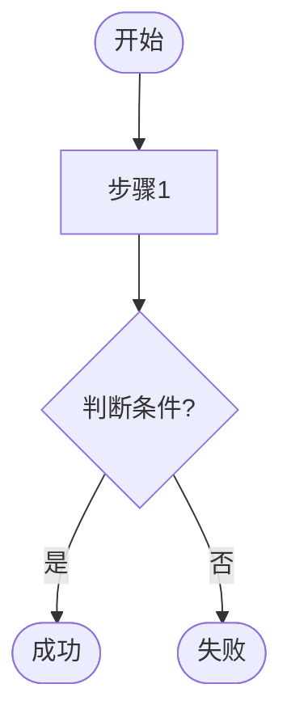
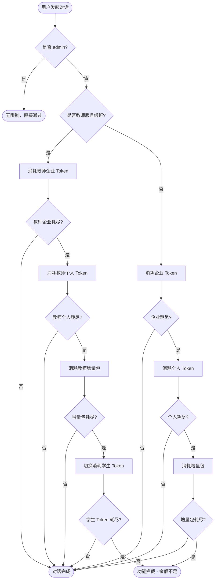

# Phase 1.5 流程图绘制指南

> 适用于 test-pipeline-mvp Phase 1.5 阶段

---

## 何时必须绘制流程图

| 场景 | 是否需要 |
|------|---------|
| 需求包含多个权限角色（admin/教师/学生） | ✅ 必须 |
| 需求有多层条件判断（if-else 嵌套） | ✅ 必须 |
| 需求涉及资源消耗顺序（Token 优先级） | ✅ 必须 |
| 简单 CRUD 操作，单一路径 | ⏭️ 可跳过 |
| 单角色、单流程、无分支 | ⏭️ 可跳过 |

---

## Mermaid 语法速查

### 基本结构



### 节点形状对照表

| 形状 | 语法 | 用途 |
|------|------|------|
| 圆角矩形 | `Start([文字])` | 开始/结束节点 |
| 矩形 | `Node[文字]` | 动作节点 |
| 菱形 | `Check{文字}` | 判断/决策节点 |
| 椭圆 | `(文字)` | 连接点 |

### 完整示例：Token 消耗流程



---

## 节点 ID 命名规范

| 节点类型 | 命名格式 | 示例 |
|---------|---------|------|
| 决策节点 | `Check{名称}` | `CheckAdmin`, `CheckToken`, `CheckRole` |
| 动作节点（通用） | 业务简写 | `P1`, `P2`, `T1`, `S1` |
| 动作节点（具名） | 动词+名词 | `ConsumeToken`, `SendNotify` |
| 成功终止 | `Done` | `Done` |
| 失败/拦截终止 | `Block` | `Block` |
| 开始节点 | `Start` | `Start` |
| 无限制通过 | `AllPass` | `AllPass` |

**原则**：
- 每个节点 ID 必须唯一
- ID 用英文或英文缩写，避免中文（Mermaid 兼容性）
- 说明文字可用中文，写在节点括号内

---

## 节点清单输出格式

绘制完成后，必须同步输出节点清单（供 Phase 3 路径绑定使用）：

```markdown
| 节点 ID | 节点描述 | 节点类型 | 优先级 |
|--------|---------|---------|------|
| CheckAdmin | 判断是否 admin 账户 | 决策 | P0 |
| AllPass | admin 直接通过 | 终止 | P0 |
| CheckTeacher | 判断是否教师版绑班 | 决策 | P0 |
| T1 | 消耗教师企业 Token | 动作 | P0 |
| P1 | 消耗企业 Token | 动作 | P0 |
| P2 | 消耗个人 Token | 动作 | P1 |
| Block | 余额不足拦截 | 终止 | P0 |
| Done | 对话完成 | 终止 | P0 |
```

---

## 在线调试工具

- **Mermaid Live Editor**: https://mermaid.live/
- **腾讯文档流程图**：适合团队协作场景，支持多人编辑

---

## 常见问题

**Q：流程图节点要多细粒度？**
A：以「业务决策点」和「状态转换点」为单位，不需要精确到每行代码。通常 5~15 个节点为宜。

**Q：一个功能需要几张流程图？**
A：按业务主流程绘制，1~3 张为宜。复杂功能可按角色分图（教师流程图 / 普通用户流程图）。

**Q：流程图和测试点的关系？**
A：流程图是坐标系，测试点是坐标系上的标记。每条测试点需标注覆盖了流程图上的哪几个节点（路径）。
